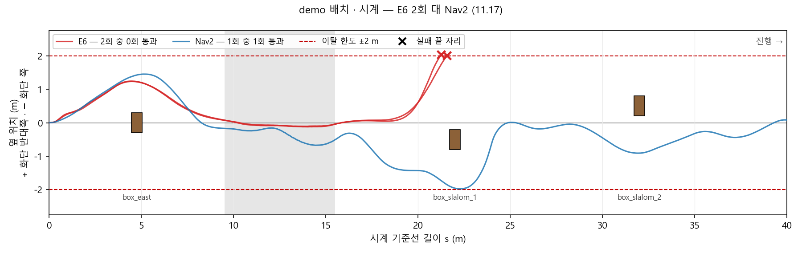

# demo 배치 폐루프 · 제로샷 사전 시험 (11.17, D 전달 9) — E6 demo 2/7 · 제로샷 1/4

- 모델: E6 `xm_ft_v1.5_aw30_exec_e6` best 에폭 5(sha256 `551cee7beb5d`, `prev_action_mode:=clamped`) · 제로샷 = 공개 `x_mobility-nav2-semantic_action_path.ckpt`(sha256 `339c68f9e027`, 노드 기본 `prev_action_mode` own, `FD_XM_ARGS` 없음).
- 실행: D 서버 11.17 10:03–10:28 · 씬 v0.8 r3 · 레포 `5a565ae972d1`(깨끗한 작업 트리) · `eval/xm_batch.sh` · LiDAR 켬 · 이탈 한도 2.0 m · 정지 10 s · 제한 시간 300 s.
- 원본: D → E 전달 9 — 묶음 5개(results.csv · 회 JSON(track) · 노드 로그 · xm_infer.csv · 메타) + `results_all.csv` 11행.
- 확인(E): 11행의 `mean_cte` · `max_cte` · `p95_cte` 를 회 JSON 궤적(`t ≥ t_goal`, `judged_samples` 까지)에서 다시 계산해 CSV 와 일치. 메타의 ckpt sha · `prev_action_mode` 도 위와 같음. `analyze_runs.py --expect-n 11` 은 D 쪽 ANALYZE_RUNS_OK(경고 1 = Nav2 행 없음).
- 폐루프 결과를 본 뒤의 **관찰 · 가설**이고 판정이 아님. 모델 · 노드는 동결 뒤라 안 바꿈. 11.20 후보는 E6 그대로.

## 한 줄

E6 는 demo 배치(장애물 6개)에서 **2/7** — 충돌 0, 실패 5회는 모두 **옳은 쪽으로 피하다가 너무 넓게 벌어져 이탈 한도 2.0 m 를 넘은 것**이다. 반시계는 보행자(`ped_north`) 옆에서(5회 중 3회), 시계는 남쪽 첫 상자(`box_slalom_1`) 0.3–0.6 m 앞에서(2회 중 2회). 통과한 2회도 최대 이탈 1.93 · 1.94 m 로 한도에 0.07 m 남았다. 같은 배치에서 Nav2(11.13 고정 18회)는 2/2 지만 시계 최대 이탈이 1.97 m 다. **demo 배치는 학습 데이터에 없다.** 제로샷은 새 하네스에서 그대로 돌았고 1/4 — 시계 2회는 첫 오른쪽 코너를 안쪽(화단 쪽)으로 2 m 파고들어 실패, 반시계 2회는 씬 출발에서 돌아서다 7–147 s 멈췄다.

## 회별 — E6 × demo

| 방향 | 출발 | 시드 | 결과 | 최대 이탈 m | 실패 자리 | 그 장애물과 나란할 때 옆 거리 m | 꺾기 시작 m |
|---|---|---|---|---|---|---|---|
| 반시계 | 씬 | 1 | **이탈** | 2.01 | 보행자 지나 0.5 m | 1.82 | 2.8 |
| 반시계 | 씬 | 2 | **이탈** | 2.01 | 보행자 지나 0.3 m | 1.92 | 2.7 |
| 반시계 | 씬 | 3 | 통과 | 1.94 | — | 1.47 | 1.5 |
| 반시계 | 맞춤 | 1 | **이탈** | 2.02 | 보행자 지나 0.3 m | 1.91 | 2.7 |
| 반시계 | 맞춤 | 2 | 통과 | 1.93 | — | 1.74 | 5.3 |
| 시계 | — | 1 | **이탈** | 2.00 | `box_slalom_1` 0.3 m 앞 | (못 지남, 최소 거리 1.44) | 5.8 |
| 시계 | — | 2 | **이탈** | 2.03 | `box_slalom_1` 0.6 m 앞 | (못 지남, 최소 거리 1.54) | 5.5 |

- 씬 출발 · 맞춘 출발은 결과가 같다(1/3 · 1/2) — D 의 읽기대로 씬 출발 탓이 아니다. 돌아선 뒤 보행자 3 m 앞(시계 s 80)까지 이탈 0.2 m 아래.
- 장애물 밖(앞 10 m ~ 뒤 6 m 바깥) 평균 이탈 회마다 0.01–0.10 m · 최대 0.22 m — 기준선 추종은 문제가 아니다.

## 옆 위치 — 시계 기준선 s 에서(시계 진행 왼쪽 + = 화단 반대쪽)

반시계, 보행자 s 77.0(중앙):

| 회 | s 81 | 80 | 79 | 78 | 77 | 76.5 | 76 | 75 | 74 |
|---|---|---|---|---|---|---|---|---|---|
| 씬 시드 1 (이탈) | −0.01 | +0.17 | +0.47 | +1.07 | +1.76 | +1.98 | 끝 | | |
| 씬 시드 2 (이탈) | +0.00 | +0.15 | +0.51 | +1.21 | +1.82 | +2.03 | 끝 | | |
| 맞춤 시드 1 (이탈) | −0.01 | +0.14 | +0.52 | +1.22 | +1.85 | +2.04 | 끝 | | |
| 씬 시드 3 (통과) | +0.09 | +0.11 | +0.15 | +0.43 | +1.38 | +1.69 | +1.80 | +1.68 | +1.09 |
| 맞춤 시드 2 (통과) | −0.05 | +0.14 | +0.56 | +1.17 | +1.69 | +1.86 | +1.93 | +1.81 | +1.39 |
| Nav2 11.13 (통과) | +0.47 | +0.90 | +1.11 | +1.22 | +1.31 | +1.30 | +1.24 | +0.92 | +0.38 |
| E6 11.12 `north_ped` 반시계(보행자 s 74.2 하나, 통과) | −0.06 | +0.01 | +0.11 | +0.12 | +0.04 | +0.03 | +0.08 | +0.45 | +0.97 |

시계, 상자 `box_east` s 4.75(중앙) · `box_slalom_1` s 22.0(옆 −0.5, 화단 쪽):

| 회 | s 4 | 6 | 10 | 14 | 18 | 20 | 21.5 | 22 |
|---|---|---|---|---|---|---|---|---|
| 시드 1 (이탈) | +1.17 | +0.97 | +0.04 | −0.12 | +0.08 | +0.53 | +2.10 | 끝 |
| 시드 2 (이탈) | +1.16 | +0.99 | +0.04 | −0.10 | +0.05 | +0.50 | +2.12 | 끝 |
| Nav2 11.13 (통과) | +1.23 | +1.36 | −0.18 | −0.61 | −1.02 | −1.43 | | −1.93 |
| E6 11.12 `east_start` 시계(`box_east` 하나, 통과) | +1.17 | +1.23 | +0.09 | −0.09 | +0.07 | +0.02 | | −0.00 |

- **반시계**: E6 는 Nav2 와 같은 쪽(화단 반대쪽)으로 피하지만 보행자 3 m 앞에서야 꺾기 시작해(Nav2 6 m) 3 m 사이에 1.7–2.0 m 를 벌린다. 5회 모두 정점이 1.80 m 이상이고 3회가 2.0 m 를 넘었다. 11.12 에 보행자 하나만 있던 배치(s 74.2)에서는 0.97 m 만 벌렸다. demo 에서는 보행자 10 m 뒤에 콘 둘(s 67, 중앙 · 화단 쪽)이 같이 보인다.
- **시계**: `box_east` 는 11.12 `east_start` 와 같은 모양으로 지난다(왼쪽 1.2 m). 그 뒤 기준선으로 돌아왔다가 `box_slalom_1`(화단 쪽으로 0.5 m 치우침) 2 m 앞에서 화단 반대쪽으로 꺾어 1.5 m 사이에 +0.5 → +2.1 m 까지 간다(상자와의 거리 1.4–1.5 m — 필요한 폭의 두 배쯤). 두 회의 궤적이 0.05 m 안으로 같다. 위 표의 꺾기 시작 5.5–5.8 m 는 코너 뒤 기준선으로 돌아오는 움직임이 잡힌 값이고, 실제로 벌어지기 시작하는 곳은 상자 2–3 m 앞이다. Nav2 는 같은 상자를 화단 쪽(−1.93 m)으로 지난다.
- 두 자리 모두 `closed_loop_cw_11_16/` 의 '코너 출구 뒤 4.5 m 안' 은 아니다(코너 출구 뒤 7–9 m). 실패 모양은 11.12 · 11.13 에 적은 **회피 폭이 한도 2.0 m 에 가깝고 들쭉날쭉하다**(`xm_ft_v1.5_aw30_exec_e6/closed_loop_11_12.md` 읽기 2 · `closed_loop_rand_ev_11_14.md` 읽기 1)와 같은 쪽이다.
- **그림(11.18 그림, 11.24 덧붙임)**: 시계 2회와 Nav2 를 겹쳐 그린 것 — [`demo_cw_strip.png`](closed_loop_demo_11_17/demo_cw_strip.png)(시계 기준선을 따라 편 옆 위치) · [`demo_cw_map.png`](closed_loop_demo_11_17/demo_cw_map.png)(위에서 본 궤적). 그리는 법은 같은 폴더 `traj_fig.py` 머리말. 11.24 에 D 에게도 보냈다.



## demo 배치와 학습 데이터 (D 질문의 답)

v1.5 의 Nav2 장애물 녹화 78개를 `index/*.json` 의 `note` 로 셈:

| 배치 | 옛 맵 v0.4b r3 (`r3_nav2_obs`, 10.14 · 11.05) | 60회 씬 v0.8 r3 (`v08r3_nav2_obs`, 11.11) |
|---|---|---|
| `obs_demo` | **없음** | **없음** |
| 고정 8종(`cones` · `corner_exit` · `east_start` · `north_ped` · `slalom` · `south_box` · `south_left` · `south_right`) × 양방향 | train 14 · val 1(`slalom` 시계) · test 1(`cones` 반시계) | 없음 |
| 무작위 `rand_tr_00–19` | train 31 · val 2 · test 2 | train 24 · val 2 · test 1 |

- demo 의 장애물 6개는 고정 배치 넷을 합친 것이다: `box_east` = `east_start`, `box_slalom_1 · 2` = `slalom`, 콘 둘 = `cones`(s 68 → 67), 보행자 = `north_ped`(s 74.2 → 77.0). 하나씩 따로 있는 배치는 **옛 맵에서만** 학습에 들어갔고, 여섯이 한 바퀴에 같이 있는 장면은 어느 맵에서도 학습에 없다.
- D 의 60회 안(아래)의 장애물 칸 넷은 모두 학습에 안 들어간 (배치, 방향)이다: demo 시계 · 반시계(녹화 없음), `slalom` 시계(val), `cones` 반시계(test).

## 제로샷 사전 시험 4회

| 시나리오 | 방향 | 결과 | 실패 자리(시계 기준선 s · 옆) |
|---|---|---|---|
| `lap` | 시계 | 이탈 2.00 m | s 10.8 · −2.04 m — 첫 오른쪽 코너(10–15)를 화단 쪽으로 파고듦 |
| `obs_south_box` | 시계 | 이탈 2.00 m | s 12.3 · −2.00 m — 같은 코너, 상자(s 28) 전 |
| `lap` | 반시계(씬 출발) | 제한 시간(가장 긴 정지 147 s) | 목표 뒤 11 s 에 s 4.5 · −1.50 m 에서 속도 명령 0 으로 147 s 멈춤, 그 뒤 다시 감 |
| `obs_cones` | 반시계(씬 출발) | 통과(206.7 s, 최대 1.48 m) | 같은 자리(s 4.7 · −1.45 m)에서 7.1 s 멈췄다가 감 |

- 하네스는 제로샷에서 그대로 돈다(`FD_METHOD=xmobility_zeroshot`, 행 · 메타 · 분석기 정상) — `eval/XM_HARNESS.md` §2 의 제로샷 줄 확인 끝.
- **반시계 2회 모두 씬 출발 직후 같은 자리에서 멈췄다.** 제로샷은 제자리에서 돌지 않고 앞으로 4.5 m 나가며 돌다가 선다. E6 · E7 은 제자리에서 6 s 에 돌아섰다(§7-1). 60회에서 제로샷 반시계 칸의 결과는 주행보다 이 돌아서기에 좌우될 수 있다 — 조건은 세 방법이 같으므로(씬 출발) 그대로 두되, 실패 사유를 볼 때 구분해서 적을 것.

## 60회에 대해 — D 의 안(11.17, 팀 · 멘토 확인 전)과 미리 적는 예상

- D 안: 24 · 24 · 12 = 칸 8(`straight_south` 시계 · `curve_se_ccw` · `lap` 시계 · 반시계 · `obs_demo` 시계 · 반시계 · `obs_slalom` 시계 · `obs_cones` 반시계) × 반복 3(seed = 반복 번호), Nav2 12 = 8칸 × 1 + 장애물 4칸 × 2(같은 짝). kind = straight · curve · obstacle · lap. 11.19–20 리허설 24회 → 11.21 스키마 v0 동결 → 11.23 모델 동결 → 11.24 실행. demo 는 11.17 결과를 보고도 빼지 않음(결과를 보고 고르지 않으려고).
- E 의견: demo 를 빼지 않는 데 동의. E 는 이 결과를 본 뒤라 칸을 고르는 데 의견을 내지 않음 — 사실만 적음: ① 장애물 4칸 중 3칸(demo 시계 · 반시계 · `slalom` 시계)이 `box_slalom_1 · 2` 또는 demo 를 포함해 서로 겹친다. ② demo 시계는 Nav2 도 1.97 m 까지 간다. ③ 시계 2회의 궤적이 0.05 m 안으로 같아, 같은 칸의 반복 3회는 독립 표본이 아닐 수 있다(통과율 구간은 칸 단위로도 볼 것).
- **60회 전 예상(E6, 지금 적어 둠)**: demo 시계 0/3 · demo 반시계 1/3 안팎 · `slalom` 시계는 demo 시계와 같은 자리(`box_slalom_1`)에서 실패할 가능성이 큼 · `cones` 반시계와 장애물 없는 4칸은 통과 → 24회 중 13–17회. 무작위 배치(11/15)보다 낮게 나오면 이 세 칸 때문.

## 재는 법

```
python3 eval/closed_loop_diag.py "E6=<전달 9>/xm_1117_e6_demo_*/runs/*_s?.json" "Nav2=<전달 6>/04_Nav2_고정18_수정뒤/parking_r3_obs_demo_c*.json" -o diag.md
python3 eval/obstacle_pass.py <전달 9>/xm_1117_e6_demo_*/runs/*_s?.json <Nav2 demo 2회> <11.12 east_start 시계 · north_ped 반시계> -o pass.md
```

옆 위치는 회 JSON track 의 x · y 를 `eval/obstacle_pass.py` 의 `load_route` · `project` 로 시계 기준선에 사영한 값(그 s 를 처음 지나는 표본). 제로샷의 멈춤은 track 의 `v_odom` < 0.05 m/s 가 이어진 가장 긴 구간.
